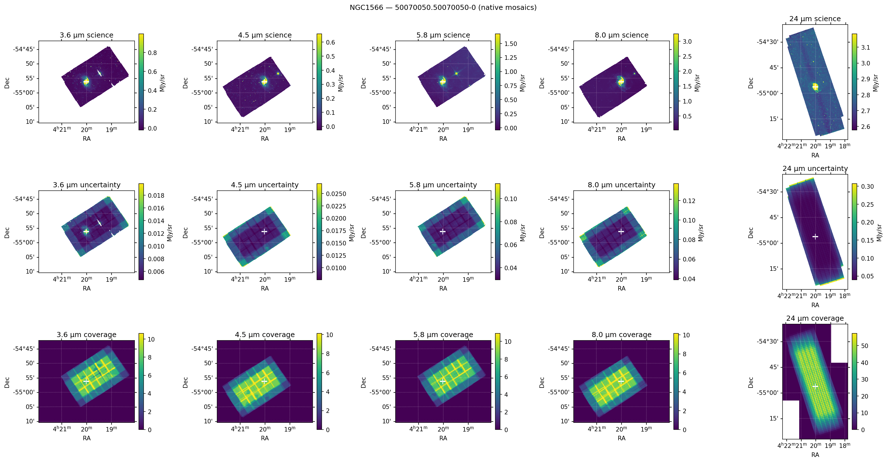
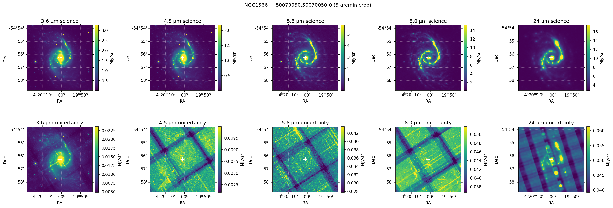

# Spitzer Downloads

Download original Spitzer Enhanced Imaging Products (SEIP) mosaics from NASA/IPAC IRSA, together with their available uncertainty and coverage FITS files. Data acquisition and visual diagnostics only; no photometry, reprojection, PSF matching or scientific analysis.

## Install

```bash
pip install --upgrade git+https://github.com/akhilkrishnar0/spitzer-downloads.git
```

## Example: NGC1566

```python
from spitzer_pipeline_class import SpitzerPipeline

pipe = SpitzerPipeline(galaxy_centers={'NGC1566': (65.0042, -54.9378)})
pipe.run(['NGC1566'], bands=['3.6','4.5','5.8','8.0','24'],
         radius_arcmin=6, skip_download=True, do_plot=True)
```

The radius is an archive search radius, not a requested cutout size. All matching archive mosaics are preserved with native WCS and units. The archive search can include mosaics that intersect the search circle but do not contain the target centre. The inventory records whether the centre lies inside each FITS grid; this is not a test for valid exposure or full galaxy coverage. Multiple mosaics are not merged. Missing products are reported, not manufactured. `skip_download=True` reuses validated FITS files; `force_download=True` refreshes them. The search is repeated to discover the current archive inventory.

## Archive query

The SIA VOTable results are read using FIELD names rather than XML IDs. The parser identifies the data-access URL from the results resource and reports archive errors and returned columns if the field is missing.

## Products

Default: `science` (`mosaic.fits`), `uncertainty` (`unc.fits`), `coverage` (`cov.fits`). Optional products include `std`, `mask`, `median_science`, `median_uncertainty`; availability is archive-dependent. Uncertainty and coverage retain their archive definitions, not converted to inverse variance.

## Outputs

```
spitzer_data/NGC1566/
    archive_query_NGC1566.ecsv
    inventory_NGC1566.csv
    downloads/<band>um/<mosaic-prefix>/<original-filename>
    plots/<mosaic-prefix>_NGC1566.png
```

Each diagnostic shows available products by band for the same mosaic prefix, with a target-centre marker when inside the grid. Native shapes may differ. Full mosaics can be large. No actual NGC1566 availability is assumed.

## Standard and short-exposure mosaics

For IRAC observations taken in high-dynamic-range (HDR) mode, SEIP constructs separate mosaics from short and long exposures. The archive assigns the short-exposure region a `-short` suffix. The corresponding region without this suffix is the standard mosaic (long-exposure mosaic for HDR observations). Short exposures help avoid saturation in bright regions; longer exposures generally offer greater sensitivity to faint emission. Inspect the FITS headers, coverage and saturation before selecting a mosaic. The package keeps both exposure groups separate and does not combine them.

For example, diagnostic filenames for NGC1566 are:

- `50070050.50070050-0-short_NGC1566.png` — short-exposure mosaic, if available.
- `50070050.50070050-0_NGC1566.png` — standard mosaic.

See the [SEIP Explanatory Supplement, section 3.3](https://irsa.ipac.caltech.edu/data/SPITZER/Enhanced/SEIP/docs/seip_explanatory_supplement_v3.pdf) and [IRSA SIA v2 SEIP example](https://irsa.ipac.caltech.edu/docs/program_interface/siav2_seip.html).

## Crop downloaded science and uncertainty images

After downloading the data, crop a manually specified box around the galaxy:

```python
pipe.crop("NGC1566", size_arcmin=5, do_plot=True)
```

Or specify the box centre manually in ICRS degrees:

```python
pipe.crop("NGC1566", size_arcmin=3, center=(65.0042, -54.9378),
          bands=["3.6", "4.5", "5.8", "8.0", "24"], do_plot=True)
```

The size is the full width of a square (5 × 5 arcmin), rounded to the native
pixel grid. No new archive query or download is needed. Matching science and
uncertainty files are cropped using the same pixel rectangle; the WCS is
checked and updated. Original pixel values, units and downloaded FITS files
are preserved. No interpolation or photometric analysis is performed. Partial
footprints are padded with NaN and reported in the inventory; pairs with
mismatched grids or missing products are skipped. Separate mosaics and native
band pixel scales are retained.

Outputs are in `spitzer_data/NGC1566/crops/<size_and_center>/`, with science
and uncertainty FITS per band and mosaic, plus a crop inventory. All diagnostic PNGs (full mosaics and crops) are saved together in `spitzer_data/NGC1566/plots/`. Cropped plots include `_crop_`, the box size and centre coordinates before the galaxy suffix to avoid overwriting plots from different crops.

Example: `50070050.50070050-0_crop_3arcmin_RA65.004200_Dec-54.937800_NGC1566.png`.

Final cropped FITS filenames follow `<mosaic-prefix>_<band>um_<product>_<galaxy>.fits`, e.g. `50070050.50070050-0_3.6um_science_NGC1566.fits`. Both full-mosaic and cropped diagnostic PNGs, and generated inventory/query tables, end with the galaxy name. Original downloaded archive FITS filenames remain unchanged to preserve provenance and allow reuse without downloading again. Previously generated files are not renamed or deleted; rerun the relevant method to generate the new names.

## References

- [IRSA SEIP image search](https://irsa.ipac.caltech.edu/data/SPITZER/Enhanced/SEIP/)
- [IRSA SEIP SIA v2 example](https://irsa.ipac.caltech.edu/docs/program_interface/siav2_seip.html)
- [IRSA SIA v2 API](https://irsa.ipac.caltech.edu/ibe/sia.html)
- [SEIP overview](https://irsa.ipac.caltech.edu/data/SPITZER/Enhanced/SEIP/overview.html)
